# Headline A/B Testing at Scale: Frequentist vs Bayesian on 1,825 Real Experiments

**Which headline should we ship, how sure are we, and how big is the effect really?**

This project studies those questions on *real* experiments from the [Upworthy Research Archive](https://upworthy.natematias.com/), a public record of every headline A/B test Upworthy ran from 2013 to 2015. It starts with one experiment analysed end to end, then applies the same methods to more than 1,800 tests. That is where most textbook A/B testing advice gets tested against reality.

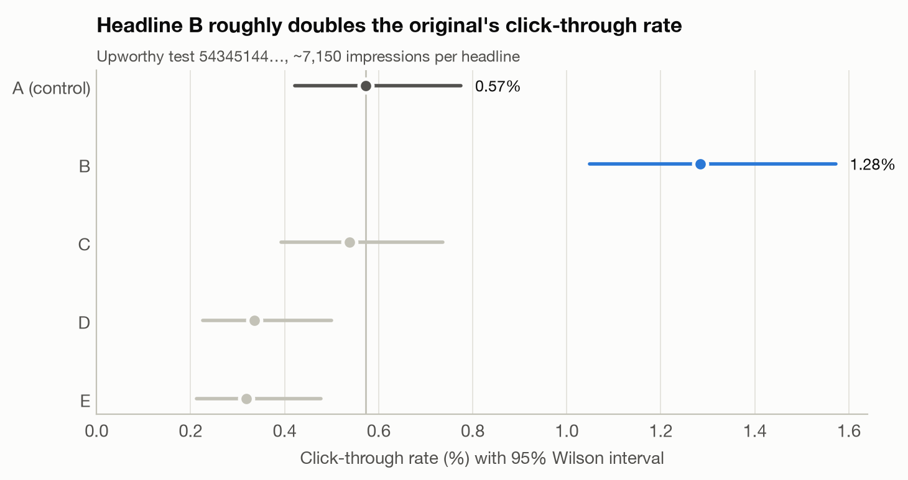

---

## Key findings

| # | Finding | Evidence |
|---|---|---|
| 1 | **In the case study, headline B beat the original by about +124%.** It survives every multiple-comparison correction, P(best) > 99.99%, and it adds about 7,100 clicks per million impressions. | Holm p = 3.5×10⁻⁵; 95% credible interval for the lift +56% to +223% |
| 2 | **A sample-ratio-mismatch check rediscovered the archive's randomization bug without being told about it.** | 70% of tests in the documented window fail SRM, vs 0.5% outside it |
| 3 | **Naive p-values are overconfident.** Arms showing the *identical* headline and image "differ" at p < 0.05 in 12.8% of comparisons, where 5% is expected. | 2,418 near-A/A comparisons; z-variance inflation φ = 1.67 |
| 4 | **Correction and calibration together cut 690 apparent winners to 230**, and to 83 under portfolio-wide FDR control. | 6,529 challenger-vs-control comparisons |
| 5 | **Most tests were badly underpowered.** The median test could only detect a +77% lift, and only 5% of tests had 80% power for a typical true effect (±38%). | Per-test MDE from each test's own baseline and traffic |
| 6 | **Winner's curse:** announced winning lifts (median +149%) shrink to +49% under empirical Bayes. | Random-effects meta-analysis + normal-normal shrinkage |
| 7 | **"Bayesian" does not mean "safe".** A flat-prior P(B > A) > 95% rule would ship a challenger in 30% of tests. A hierarchical prior ships in 8%, close to calibrated Holm (9%). | Decision-rule comparison across 1,825 tests |
| 8 | **Peeking is costly under both paradigms.** Checking every 200 impressions gives a 27% false-positive rate for the z-test and 42% for a Bayesian 95% rule. A Pocock boundary keeps it at 4%. | 40,000 simulated A/A tests |
| 9 | **Headline-writing habits that replicated on held-back data:** numbers (+6%), "this/these/here's" (+5%), negative words (+7%), longer headlines (+10% per 10 words); questions (−8%) and exclamation marks (−6%) hurt. | Explored on 1,825 tests, pre-registered, confirmed on 8,794 new tests |

---

## Project structure

| Notebook | Question | Methods |
|---|---|---|
| [`01_experiment_case_study`](notebooks/01_experiment_case_study.ipynb) | Should we ship headline B? | Experiment design, SRM, Wilson CIs, χ² omnibus, two-proportion z-tests, Bonferroni / Holm / BH, power & MDE, Beta-Binomial posteriors, P(best), expected loss, prior sensitivity, practical significance |
| [`02_portfolio_meta_analysis`](notebooks/02_portfolio_meta_analysis.ipynb) | What do 1,825 tests say about the process? | SRM audit, A/A calibration, within-test vs portfolio-wide correction, DerSimonian–Laird random effects, empirical-Bayes shrinkage, frequentist vs Bayesian decision rules |
| [`03_simulations`](notebooks/03_simulations.ipynb) | Why does it go wrong? | Monte Carlo: peeking (incl. Bayesian stopping), group-sequential (Pocock) boundaries, FWER/power vs number of arms, type M & type S errors, sample-size planning |
| [`04_headline_features`](notebooks/04_headline_features.ipynb) | What makes a headline win? | Within-test fixed-effects WLS on log-odds, cluster-robust SEs, explore → pre-register → confirm on held-back data |

```
headline-ab-testing/
├── src/abtest/            # reusable, unit-tested library
│   ├── data.py            # loading, cleaning, test classification, arm tables
│   ├── frequentist.py     # z-test, Wilson CI, lift CIs, SRM, omnibus χ², corrections
│   ├── bayesian.py        # Beta-Binomial posteriors, P(best), expected loss, priors
│   ├── power.py           # sample size, power, minimum detectable effect
│   ├── meta.py            # log odds ratios, random-effects pooling, EB shrinkage
│   ├── simulate.py        # peeking, multiple arms, winner's curse simulations
│   └── plotting.py        # shared, colorblind-validated figure style
├── notebooks/             # executed analysis notebooks (01–04)
├── reports/figures/       # every figure in this README
├── reports/results/       # JSON/CSV outputs behind every number quoted here
├── scripts/download_data.py
└── tests/test_stats.py    # 13 unit tests (checked against statsmodels and known answers)
```

---

## 1 · Case study: one experiment, done properly

**Design.** One story, five headlines, about 7,150 impressions each, with impressions randomly assigned to arms. The control is the editor's first draft. Every other headline is a challenger. The decision rule was fixed before looking at the data: ship only if the challenger is Holm-significant against control **and** has Bayesian P(best) ≥ 95% with expected loss < 0.01 pp.

| Headline | CTR | vs control | Holm p |
|---|---|---|---|
| **A (control):** *These Stats Are Heartbreaking Because This Is So Real … And Happening In Your Neighborhood.* | 0.57% | — | — |
| **B:** *They're Just A Bunch Of Little Doodles In A Kid's Notebook. So Why Is It So Upsetting?* | **1.28%** | **+124%** [+56%, +224%] | **0.00004** |
| C | 0.54% | −6% | 0.78 |
| D | 0.34% | −41% | 0.07 (BH: 0.047) |
| E | 0.32% | −44% | 0.07 (BH: 0.045) |

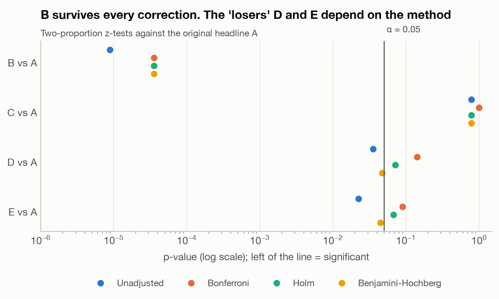

The *choice of correction* changes the story about D and E. That is why the correction is set before the data arrives.

**Power.** This test could only reliably detect a +71% lift (+87% with Bonferroni). Detecting a 10% lift would have taken about 57× more traffic. B's lift was large enough to clear that bar. Most real effects are not.

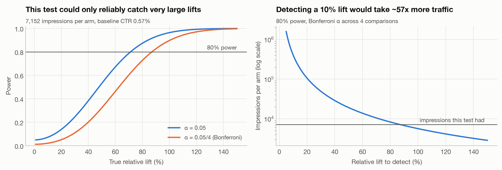

**Bayesian view.** P(B > A) > 0.9999. The posterior median lift is +123% (95% CrI +56% to +223%). Expected loss from shipping B is effectively zero. The conclusion does not change under a portfolio-informed prior or a deliberately skeptical prior worth 20,000 pseudo-impressions per arm.

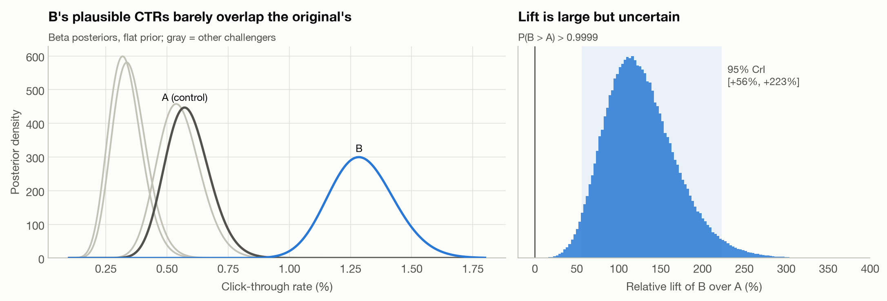

**Decision: ship B.** It is statistically clear, robust to the prior, and practically meaningful at about 7,100 extra readers per million impressions. The lift itself is uncertain, though. Plan on something closer to the lower end of the interval, for the reasons in section 2.

---

## 2 · Portfolio: what 1,825 tests reveal

### Guardrails first: the randomization audit
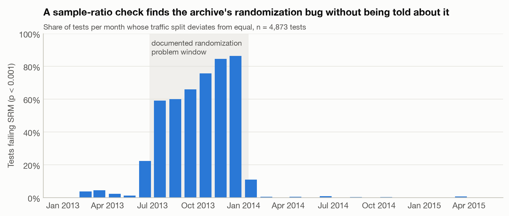

A one-line chi-square check on the traffic split flags 70% of tests in the window that the archive's maintainers later reported as broken, and almost nothing outside it. **Run an SRM check on every experiment before reading its outcome.**

### A/A calibration: are the p-values honest?
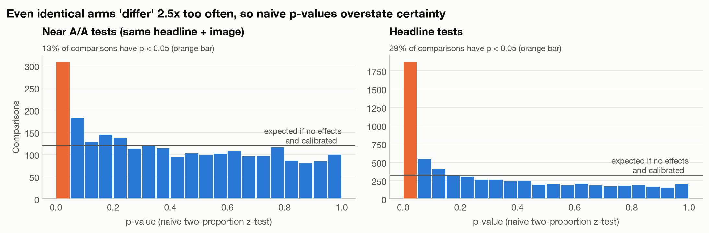

Tests whose arms showed the same headline and image should produce uniformly distributed p-values. Instead, 12.8% fall below 0.05. Under the null the z-statistic's variance is about 1.67× what a binomial model assumes. Likely causes are repeat impressions per visitor and shifts in traffic mix. Dividing z by √1.67 restores a 5.4% false-positive rate, and every later portfolio result uses calibrated p-values.

### Multiple comparisons at two levels
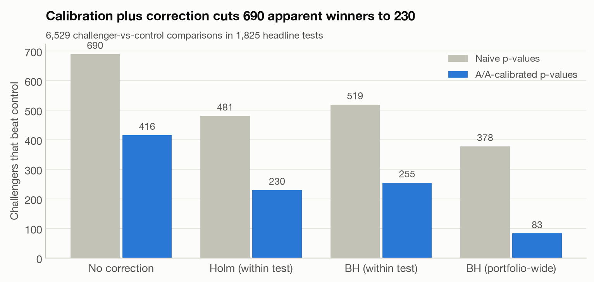

### How big are real headline effects, and could the tests see them?
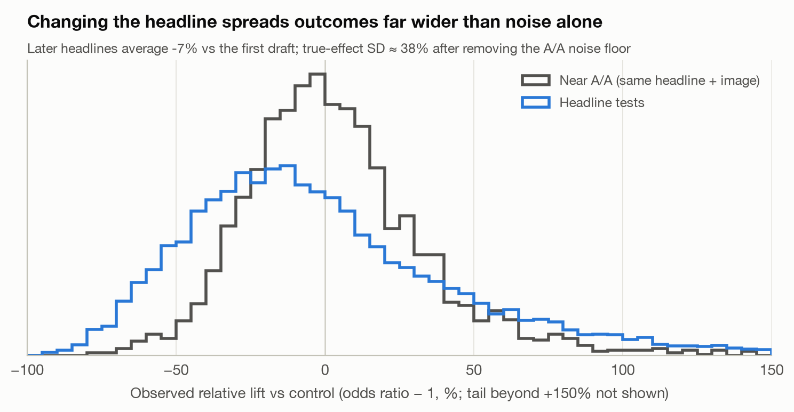

Random-effects meta-analysis puts the SD of true headline effects at 0.32 on the log-odds scale (about ±38%), after removing the noise floor measured in near-A/A tests. On average, later drafts did 7.5% *worse* than the editor's first headline.

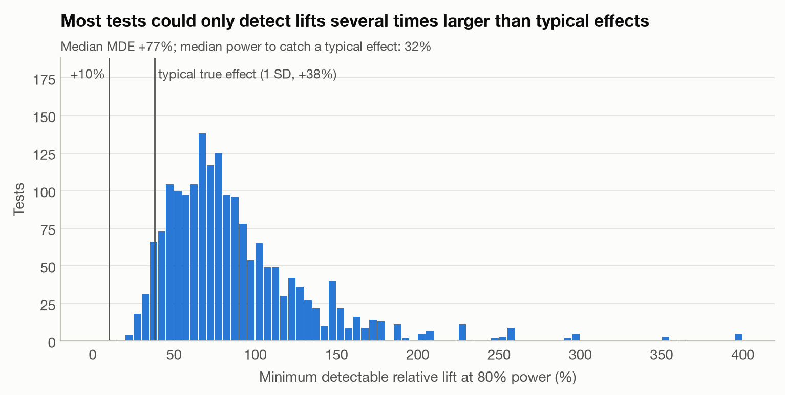

### Winner's curse
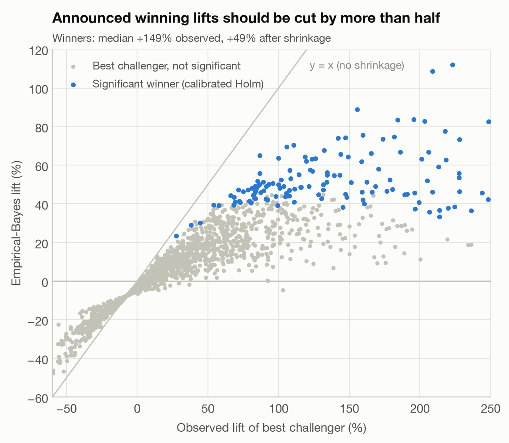

### Frequentist vs Bayesian decisions

| Rule | Tests that ship a challenger |
|---|---|
| Bayesian, flat prior, P(B > A) > 95% | 552 (30.2%) |
| Naive Holm | 330 (18.1%) |
| A/A-calibrated Holm | 166 (9.1%) |
| Bayesian, hierarchical (EB) prior | 153 (8.4%) |

A Bayesian analysis only protects against false winners when its prior carries real information. With a hierarchical prior it lands close to a well-calibrated frequentist analysis.

**Upworthy's own dashboard** crowned a leader in every test, but only 7% of those leaders were (calibrated) significantly better than the runner-up.

---

## 3 · Simulations: isolating each failure mode

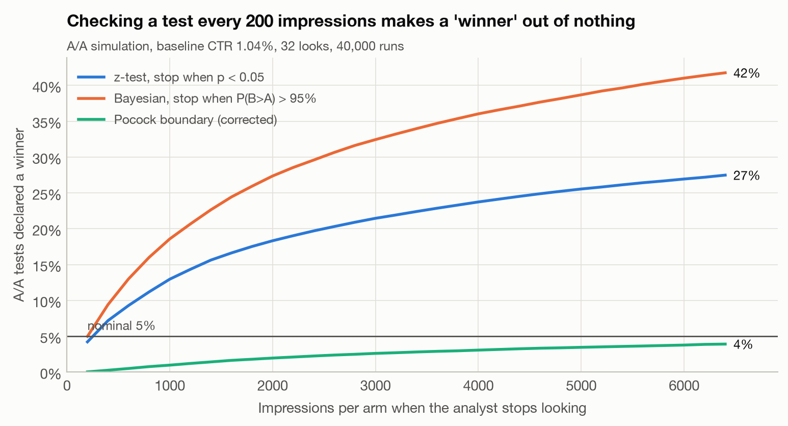
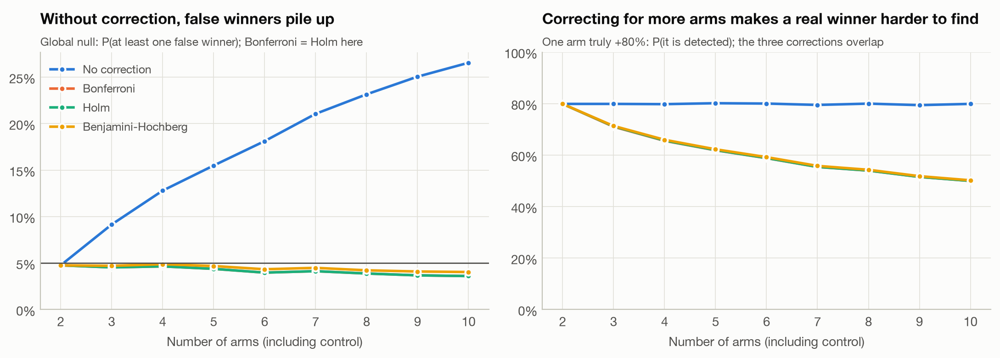
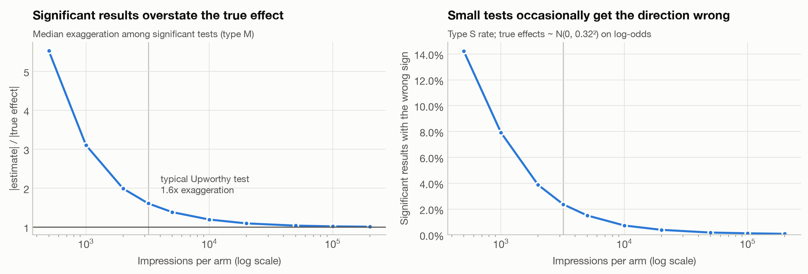

**What a well-designed test would need** at a 1.04% baseline CTR with 4 challengers (Bonferroni, 80% power, A/A-calibrated):

| Target lift | Impressions per arm | vs a typical Upworthy test |
|---|---|---|
| +38% (a typical true effect) | 28,951 | 9× |
| +20% | 97,116 | 30× |
| +10% | 371,553 | 116× |

---

## 4 · What makes a headline win? (explore → confirm)

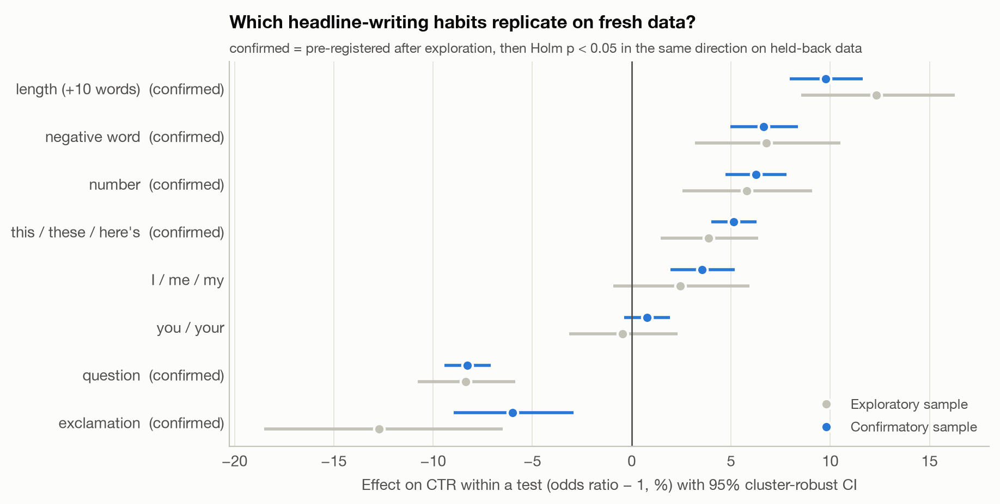

Eight features were tested on the exploratory sample with BH correction. The six with q < 0.10 were pre-registered and **all six replicated** on 8,794 new tests in the confirmatory sample (Holm p < 0.05, same direction). First-person words ("I / me / my") were significant only in the confirmatory sample. Because they were not pre-registered, they count as a hypothesis for the next round, not a finding. The negative-word result is consistent with Robertson et al. (2023), who studied the same archive.

> These are within-test comparisons, so they hold the story, image and audience fixed. They are still observational with respect to the features: headline writers did not randomize *which* features to use.

---

## Recommendations for a headline-testing program

1. **Gate every readout on an SRM check**, and periodically run A/A tests to calibrate the test statistic.
2. **Pre-register the metric, horizon, correction and decision rule.** Use Holm within a test for ship decisions, and BH across the portfolio when screening ideas.
3. **Do not peek with fixed thresholds.** This applies to Bayesian thresholds too. Use planned group-sequential boundaries or always-valid inference.
4. **Size tests for realistic effects.** Test fewer headlines with more traffic each, or accept that only large wins are detectable.
5. **Report shrunken lifts.** Forecast impact from empirical-Bayes estimates, not raw winning lifts.
6. **Pair the p-value with a business translation:** absolute lift, clicks per million, P(best) and expected loss.

---

## Reproduce

```bash
git clone <this-repo> && cd headline-ab-testing
python -m venv .venv && source .venv/bin/activate
pip install -r requirements.txt
python scripts/download_data.py      # ~80 MB from OSF (exploratory + confirmatory samples)
pytest -q                            # 13 unit tests
jupyter nbconvert --to notebook --execute --inplace notebooks/0*.ipynb
```
Or simply `make all`. Every number in this README is written to `reports/results/` by the notebooks.

## Data, limitations and ethics

- **Data:** Matias, J. N., Munger, K., Aubin Le Quere, M., & Ebersole, C. (2021). *The Upworthy Research Archive, a time series of 32,487 experiments in U.S. media.* Scientific Data 8, 195. Licensed CC BY 4.0. The raw data is not redistributed here. The download script fetches it from [OSF](https://osf.io/jd64p/). The archive's **holdout** sample is never used.
- **Aggregate data only:** impressions, not people. Visitor-level correlation is handled through A/A calibration and cluster-robust SEs, not modelled directly.
- **Control definition:** Upworthy had no formal control, so the first-drafted headline plays that role.
- **Problem window:** tests from 25 Jun 2013 to 10 Jan 2014 are excluded, following the maintainers' guidance.
- **Near A/A tests** may still differ in fields the documentation says were not shown (excerpt, share text). If those fields did matter, the calibration is conservative.

## References

- Benjamini, Y., & Hochberg, Y. (1995). Controlling the false discovery rate. *JRSS B.*
- DerSimonian, R., & Laird, N. (1986). Meta-analysis in clinical trials. *Controlled Clinical Trials.*
- Deng, A. (2015). Objective Bayesian two sample hypothesis testing for online controlled experiments. *WWW '15 Companion.*
- Fabijan, A., et al. (2019). Diagnosing sample ratio mismatch in online controlled experiments. *KDD.*
- Gelman, A., & Carlin, J. (2014). Beyond power calculations: assessing type S and type M errors. *Perspectives on Psychological Science.*
- Holm, S. (1979). A simple sequentially rejective multiple test procedure. *Scandinavian Journal of Statistics.*
- Pocock, S. J. (1977). Group sequential methods in the design and analysis of clinical trials. *Biometrika.*
- Robertson, C. E., et al. (2023). Negativity drives online news consumption. *Nature Human Behaviour.*

Code is released under the MIT License.
